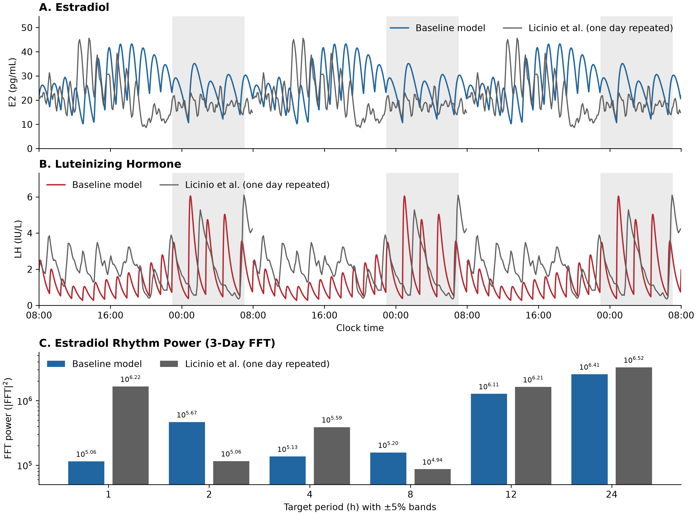

# HPG model

A computational model of the hypothalamic-pituitary-gonadal (HPG) axis and
estradiol rhythms. This repository contains the Meeting 15 model, analysis
scripts, digitized reference traces, and saved figures and numerical results.

The feedback loop links estradiol (E2), a central regulatory state (N), pulsatile
gonadotropin-releasing hormone (GnRH), luteinizing hormone (LH), and ovarian
responsiveness (R). A daily sinusoidal suprachiasmatic nucleus (SCN) signal
modulates GnRH pulse amplitude; sleep separately lengthens the interpulse period.



## Install and run

Install Python 3 and the dependencies from the repository directory:

```shell
python -m pip install -r requirements.txt
python figure1.py
```

`figure1.py` saves `figure1.png` beside the script. It plots three days of model
E2 and LH against digitized reference traces and compares E2 FFT band powers.
The plotting scripts save PNG files without opening a GUI.

To use the model directly:

```python
from MODEL import STEP_H, WARMUP_H, simulate_endocrine

trace = simulate_endocrine()
first = round(WARMUP_H / STEP_H)
hours_after_warmup = trace["time_h"][first:] - WARMUP_H
ovarian_e2 = trace["E2"][first:]
lh = trace["LH"][first:]

# Change parameters by keyword; unspecified parameters retain their defaults.
variant = simulate_endocrine(scn_min=30, sleep_multiplier=1.3)

# Return only seven-minute ovarian E2 samples after warmup for FFT analysis.
samples = simulate_endocrine(for_fft=True)
```

## Model equations

`MODEL.py` is the shared model source. Time `t` is measured in hours from 08:00.
Define activating and inhibitory Hill functions as

```math
H(x;K,h)=\frac{x^h}{K^h+x^h},\qquad
I(x;K,h)=\frac{K^h}{K^h+x^h}.
```

Between GnRH pulse events, the state equations are

```math
\begin{aligned}
\dot N &= k_N\left[g_N I(E+E_{\mathrm{added}};K_E,h_E)-N\right],\\
\dot G &= -k_G G,\\
\dot L &= g_L G-k_L L,\\
\dot R &= \left[I(L;K_R,h_R)-R\right]/\tau_R,\\
\dot E &= b+v H(L;K_A,h_A)R-k_E E,\\
\dot\phi &= \frac{60}{P(N)M_{\mathrm{sleep}}(t)},\\
P(N) &= P_{\max}-(P_{\max}-P_{\min})H(N;1,h_P).
\end{aligned}
```

Here `G`, `L`, and `E` denote GnRH, LH, and ovarian E2; `phi` is the pulse
timer. Its period `P` is in minutes, accounting for the factor of 60. The
responsiveness time constant `tau_R` is fixed at one hour. Hormone decay rates
are `60 * log(2) / half_life_min`, in inverse hours.

The daily SCN signal and pulse jump are

```math
\begin{aligned}
S(t) &= \frac{S_{\max}+S_{\min}}{2}
       +\frac{S_{\max}-S_{\min}}{2}
        \cos\left(\frac{2\pi(t-\theta)}{24}\right),\\
\Delta G &= J H(N;1,h_J)S(t)
       \left(\lfloor\phi_{\mathrm{next}}\rfloor-\lfloor\phi\rfloor\right).
\end{aligned}
```

The sleep multiplier is 1.55 from 23:00 up to 07:00 and 1 otherwise. The
three central Hill exponents are independent: E2-to-N feedback
(`e2_feedback_exponent`), N-to-pulse period (`n_period_exponent`), and
N-to-pulse amplitude (`n_amplitude_exponent`).

`added_e2` is a constant concentration added to E2 in the N feedback term.
The returned `E2` trace remains ovarian E2. `plot_added_e2.py` adds the constant
back when plotting total E2.

## Default parameters and numerical method

The defaults are declared in `REFERENCE` and in `simulate_endocrine`:

| Parameter | Default | Role |
| --- | ---: | --- |
| `constant_inflow` | 6 | Basal E2 production rate, pg/mL per hour |
| `production_scale` | 210.7 | Maximum LH-driven E2 production rate, pg/mL per hour |
| `activation_midpoint` | 1 | LH activation midpoint |
| `activation_exponent` | 5 | LH activation steepness |
| `inhibition_midpoint` | 1 | LH desensitization midpoint |
| `inhibition_exponent` | 5 | LH desensitization steepness |
| `n_gain` | 1 | Maximum N feedback target |
| `n_e2_midpoint` | 30.2 | E2 feedback midpoint, pg/mL |
| `e2_feedback_exponent` | 2.36 | E2-to-N feedback steepness |
| `n_period_exponent` | 2.36 | N-to-GnRH period steepness |
| `n_amplitude_exponent` | 2.36 | N-to-GnRH amplitude steepness |
| `n_relaxation` | 1 | N relaxation rate, per hour |
| `gnrh_pulse_jump` | 1 | GnRH pulse amplitude scale |
| `lh_gnrh_gain` | 1 | GnRH-to-LH production gain |
| `period_min`, `period_max` | 67.5, 76.73 | Lower and upper interpulse-period bounds, minutes |
| `scn_min`, `scn_max` | 35, 277 | Sinusoidal SCN bounds |
| `sleep_multiplier` | 1.55 | Sleep-time interpulse-period multiplier |
| `scn_phase` | 16.65 | Hours after 08:00 to the SCN peak, at 00:39 |
| `gnrh_half_life_min` | 4.09 | GnRH half-life, minutes |
| `lh_half_life_min` | 29 | LH half-life, minutes |
| `e2_half_life_min` | 22.53 | E2 half-life, minutes |
| `added_e2` | 0 | Constant added E2 concentration, pg/mL |

The solver uses forward Euler with a 1.5-second step. Every update uses the
state at the beginning of that step; an integer crossing of the updated pulse
timer supplies the GnRH jump. The default run includes a 96-hour warmup and
72 hours of output. Both integration and the post-warmup window begin at 08:00.

Initial values are GnRH = 0, LH = 3, ovarian E2 = 19, and pulse phase = 0.
N starts at its E2-dependent feedback target, and R starts at its LH-dependent
inhibitory target. Normal output includes warmup and contains `time_h`, `N`,
`GnRH`, `LH`, `E2`, `phi`, `R`, `SCN`, and `sleep_indicator`.

The model also supports NumPy broadcasting for the parameter combinations used
in the supplied sweeps. Time is always the last axis of the returned traces.

## Analyses and figures

Run these commands from the repository directory:

| Command | Analysis and output |
| --- | --- |
| `python figure1.py` | Three-day E2/LH comparison and E2 band powers; saves `figure1.png` |
| `python digitize_licinio.py` | Digitizes the supplied reference image; saves `licinio_e2.npy` and `licinio_lh.npy` |
| `python plot_added_e2.py` | Baseline versus constant added E2 of 30 and 100 pg/mL; saves `added_e2_30_100.png` |
| `python scn_minimum_rhythm_heatmap.py` | SCN minima from 25 to 45 in steps of 0.1, with three-day FFTs; saves `scn_minimum_rhythm_heatmap.png` |
| `python sleep_multiplier_rhythm_heatmap.py` | Sleep multipliers from 1 to 2 in steps of 0.005, with 42-day FFTs; saves `sleep_multiplier_rhythm_heatmap.png` |
| `python steepness_2d_heatmaps.py` | Joint LH-desensitization and N-to-pulse-amplitude sweep, with 42-day FFTs; saves `lh_amplitude_joint_heatmaps_relative.png` |
| `python figure4.py` | Median nighttime E2 pulse amplitude over the joint steepness grid; saves `figure4.png` |

The two joint-grid scripts use 401 values per axis (1 to 5 in steps of 0.01),
or 160,801 parameter combinations. They recompute simulations when run and can
take substantial time and memory. Existing figures can be viewed directly.
Figure 4 measures each nighttime peak relative to the higher of its two
neighboring troughs, then takes the median over the 42-day analysis window.

## FFT convention

`rhythm_fft.py` samples E2 every seven minutes and calculates raw
`abs(numpy.fft.rfft(samples))**2`. It omits the zero-frequency bin and sums
power within +/-5% of the target periods 1, 2, 4, 8, 12, and 24 hours. It
does not subtract the mean, detrend, taper, or divide by the sample count.

The default three-day window contains 618 samples and excludes the endpoint.
The 42-day sweeps use a longer record. Raw squared FFT power depends on record
length, so compare absolute powers only for matching sampling and durations.
Relative heatmaps divide each band's power by the baseline under that sweep's
own settings.

The reference E2 and LH traces are digitized from the supplied
`Licinio_E2_LH.png` image. The digitization script identifies them as Subject 2
from Licinio et al. (1998). Figure 1 repeats one digitized day across three
days, using periodic interpolation for the FFT comparison; these are not
three independently measured days.

## Files and saved results

- `MODEL.py`: shared solver and baseline parameters.
- `rhythm_fft.py`: FFT and band-power helpers.
- `digitize_licinio.py`, `Licinio_E2_LH.png`, and `licinio_*.npy`: reference
  digitization code, source image, and exported traces.
- `model_cache.py`: model-hash provenance helpers for saved arrays and CSVs.
- Plotting and sweep scripts: analyses listed above.
- PNG, CSV, and NPZ files: saved Meeting 15 figures and numerical snapshots.

The CSV/NPZ snapshots are included as supplied. Current plotting scripts do
not necessarily regenerate those archives, and model-hash helpers are not
automatically applied by every script. Use a fresh simulation when results
must correspond to the current solver and parameters.
